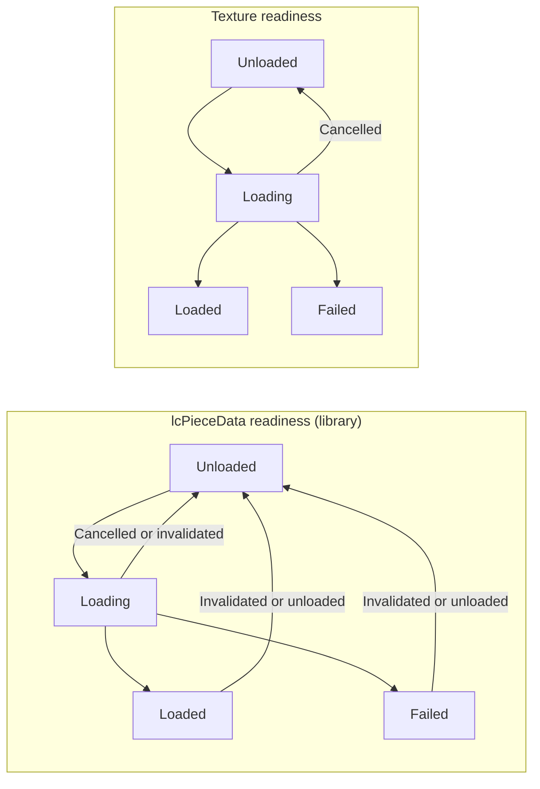
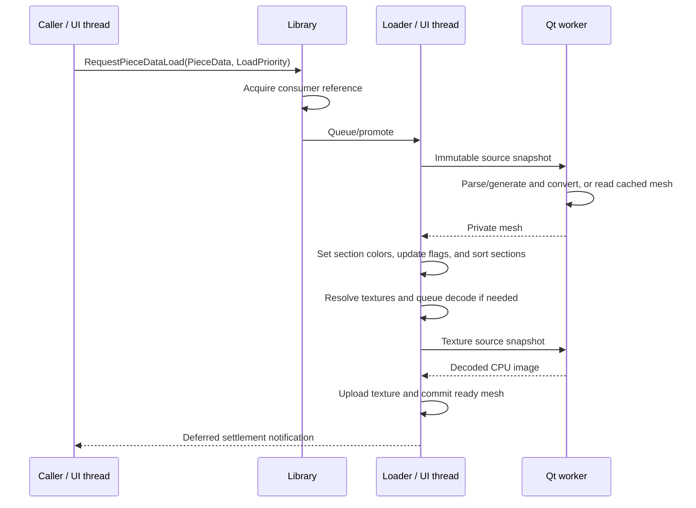

# Asset loading

This guide describes the current implementation. Update it with changes to
loading, ownership, readiness, scheduling, or output policy. Names below refer
to existing APIs, rather than proposed interfaces.

This is the implementation record replacing the streaming-assets plan. It
documents the current contracts and accepted decisions, rather than retaining
completed stages or superseded proposals as future requirements.

## What users see

Opening a model still parses its file on the UI thread, but does not wait for
every referenced mesh or texture. Unavailable geometry initially draws as cubes;
pieces appear incrementally once their meshes **and textures** are ready.
Already-loaded shared assets can appear immediately. A disk cache hit still
requires worker loading and any texture dependencies; it is not a UI-thread fast
path and receives no special queue priority.

The status-bar spinner is visible while the active project has pending pieces
or generated meshes. Its tooltip reports loading counts, or regeneration when
only synth work remains. Counts describe unique required `lcPieceData` identities
plus generated piece instances, not the number of placed bricks or global jobs.
Requirements include all project models and their nested dependencies, not just
the visible step. The spinner hides immediately when work settles; there is no
"all pieces loaded" message. A separate failure indicator retains error details
until the project's failures disappear or the project changes.

Views redraw and update bounds as results arrive, but keep the user's camera.
Interactive and output camera fits go through `lcView::ZoomExtents()`, with
fallback geometry included for interactive views and only available geometry
included for outputs. The view delegates fitting and saved camera undo history
to `lcModel::ZoomExtents()`. `lcView::ZoomExtentsAtStep()` restores the model's
current step after fitting.
The adjustment flag passes through view, model, and camera. The camera adjusts
clipping after updating its fitted position, using the fit's transformed bounding
points without collecting bounds again.
The view fit entry points take an explicit `AdjustFarPlane` flag. Initial view
and preview fits and automatic image output fits enable it, using the bounds
available at that time; ordinary fits disable it. The distance expands only when
those bounds extend beyond both the default 50,000 and the current distance. Later asset
updates, redraws, navigation, and fits do not adjust clipping again.
Increases include a 10% margin and round up to multiples of 10,000; they never
shrink the distance or change saved model cameras. Explicit command-line clipping
planes remain authoritative for image output.
Restored tab layouts defer clipping adjustment until the ordinary camera's saved
position and settings have been applied, so a saved distance cannot undo the
load-time expansion. Named model cameras retain their saved clipping settings.
During synth edits, the previous generated mesh stays visible until a replacement
settles. Images and geometry exports wait for their requirements and omit failed
geometry instead of saving loading cubes. See [Caller policies](#caller-policies)
for the deliberately stricter preview rules and thumbnail fallbacks.

## Accepted decisions

These decisions are the baseline, not open TODO items. Do not propose reversing
them merely because another design is possible or an older requirement differs.
Revisit one only at the user's request or when a concrete regression, changed
requirement, or relevant measurement invalidates its rationale. Explain that
new evidence and update this record with any agreed change.

| Decision | Rationale and alternatives set aside |
| --- | --- |
| Keep identities, sources, references, and shared buffers in the library; pending work belongs to its loader. | One registry and one completion path avoid competing lifetime/readiness authorities. Do not create a second asset registry in the loader. |
| Use the existing Qt worker pool and shared offscreen GL context, with UI-thread publication. | Reuses existing infrastructure and keeps model mutation, color registration, upload, and rendering sequential. Do not publish assets from workers or introduce a separate renderer/context for loading. |
| Use promotion-only priorities and existing reference counts. | Models open at their last step; precise consumer demotion added bookkeeping for little demonstrated benefit. Per-consumer pointer maps, step-based priorities, outgoing-project demotion, and scoped priority removal were deliberately set aside. Accept briefly elevated work after a requesting view closes. |
| Treat missing geometry as `Failed`; keep structural type and library membership separate. | A separate Placeholder/Missing type or readiness value duplicates failure state. Cubes are shared display fallbacks, not stored asset meshes. Library membership is established explicitly by the `lcPieceData` constructor. |
| Require all includes and textures for successful asset loading; never cache an erroneous mesh as successful. | Partial private builds must not masquerade as ready assets. Permissive output is a caller policy that omits failed assets, not relaxed loader success criteria. |
| Allow model outputs to save available geometry after waiting. | Geometry exports, HTML, images, instructions, and printing do not reject the whole operation because an asset failed. Actual rendering/file failures remain errors. Strict previews and thumbnail fallback rules remain separate. |
| Keep missing HTML parts-list entries with empty thumbnails and quantities. | Missing geometry must not erase the inventory entry or substitute a loading cube. Instruction parts lists currently omit unavailable thumbnails. |
| Fit outputs to available geometry; interactive fitting includes fallbacks. | Failed cubes must not distort exported framing. Include root direct geometry and available children, preserve explicit cameras, and never automatically refit interactive views as assets arrive. |
| Build synth meshes per instance on workers; retain the previous generated mesh during edits and cancel obsolete work cooperatively. | Control points belong to placements, not shared library assets. Keep interactive edits stable while ensuring output never mistakes an older mesh for the completed replacement. |
| Keep the uncached mesh draw path and debounced shared-buffer repacking. | Measured repacking cost was small and repeated scenes benefited from shared buffers. Per-mesh buffers, visibility-triggered uploads, and mesh-buffer upload as a readiness requirement were set aside without evidence of a benefit. Texture upload remains part of readiness. |

## Responsibilities and entry points

| Owner | Responsibility | Source |
| --- | --- | --- |
| `lcPiecesLibrary` | Piece identities and references, all source discovery and lookup, texture file indexes, archives, primitive and mesh caches, settings, shared mesh buffers, and public forwarding APIs. Owns the texture manager and supplies its archive reader. | [lc_library.h](../common/lc_library.h), [lc_library.cpp](../common/lc_library.cpp) |
| `lcTextureManager` | Texture identities and references, snapshots, and private CPU decoding of resolved sources. | [lc_texturemanager.h](../common/lc_texturemanager.h), [lc_texturemanager.cpp](../common/lc_texturemanager.cpp) |
| `lcAssetLoader` | Pending requests, worker scheduling, private results, texture upload, publication, cancellation, readiness waits, and deferred settlement notifications. | [lc_assetloader.h](../common/lc_assetloader.h), [lc_assetloader.cpp](../common/lc_assetloader.cpp) |
| `lcPieceData` / `lcTexture` | Published geometry or texture data, readiness state, and asset metadata. | [lc_piecedata.h](../common/lc_piecedata.h), [lc_texture.h](../common/lc_texture.h) |
| Projects, models, and views | Project-local names, required-asset traversal, generated-piece ownership, bounds, fallback display, cameras, and redraws. | [project.cpp](../common/project.cpp), [lc_model.cpp](../common/lc_model.cpp), [piece.cpp](../common/piece.cpp) |

The library owns the loader. Call library entry points from the UI thread for
asset acquisition, release, scheduling, waiting, and invalidation. Workers use
source snapshots and the library's build services; they do not consult the
active project or publish into live models.

The texture manager is owned by the library and owns the only texture registry.
`FindTextureDeferred()` resolves embedded data, project-directory files, and
indexed library files in the library, then asks the manager to acquire an identity
for that resolved source. The lookup returns the source snapshot alongside the
acquired identity so callers can pass it to loader requests without reading texture fields.
Resolution preserves the prefixed search order and
canonicalizes disk paths. The project directory is passed separately to acquisition
so the manager preserves temporary-texture metadata without searching files itself.
Library texture APIs forward reference changes and decoding to the manager.
`FindTexture()` still gathers the explicit project's context and waits through
the loader. Texture requests,
priority promotion, cancellation, upload/retries, and part dependency settlement
remain in `lcAssetLoader`; its in-flight texture references are acquired through
the manager. Shared readiness, priority, file-source and piece-source snapshots,
build results, and `lcTextureLoadError` live in `lc_assettypes.h`. Stud-style and
archive-type enums remain in `lc_library.h` and are forward-declared by the shared
header; the piece snapshot constructor supplies their defaults out of line.
`lcTexture::mSource` stores the source identity; copies for workers do not snapshot
file contents. Texture names, project directories, and temporary flags remain separate.
Callers pass the resolved source into each texture request. The library's
`BuildTextureData()` and `AddTextureReference()` are internal loader services,
accessible through the existing `lcAssetLoader` friendship.

The library calls `OpenFile()` on the reading thread and passes the opened
`lcFile&` to the texture manager for decoding. `BuildTextureData()` continues to
run on a worker, so file opening and archive extraction stay on that worker. The
manager stores no file-reader callback or library instance.
Success returns an owned `lcFile` positioned at zero: disk sources retain
an open `lcDiskFile`, archive entries and decoded embedded data use `lcMemFile`.
Opening never searches for another source or parses its contents. Failures carry
an error; the caller retains the result while consuming the file. Archive access
is unlocked before image decoding, and returned memory files are independent of
their archive or embedded source. Each `lcZipFile` serializes its own extraction;
the library adds no archive-wide mutex. Archive replacement and closure remain
protected by draining/pausing workers first. Texture identities use the
manager's own mutex; source indexes and source resolution belong to the library.
Library unload drains loader work, destroys meshes that release texture references,
clears the texture manager, then closes archives. Workers must be drained before
the manager is cleared or archive indexes are replaced.

`lcTextureManager::DecodeTextureData(lcFile&)` decodes disk files through their existing `QFile` and
memory files through `QImage::loadFromData()`, without an additional device adapter
or disk-to-memory copy. Disk cursor restoration runs on success and failure;
memory decoding leaves the cursor unchanged and validates the remaining buffer
length. Qt handles disk reads, seeking, EOF, and I/O errors. Files/cursors are
private to each request, not shared between workers. Texture readiness waits use
the same loader worker path; unused direct texture-loading overloads and their
synchronous library/manager forwarding chain have been removed.

Decoded worker results hold a `QImage`, normalized to RGB888 or RGBA8888 and
scaled with Qt's smooth transformation to the existing power-of-two dimensions.
Textures retain the decoded `QImage` through upload without a second pixel buffer.
Uploads honor Qt's scanline alignment, packing unusual row strides only when
needed. CPU mipmap generation copies pixel rows without padding into its existing
working buffer; its filtering, OpenGL formats, and shaders remain unchanged.
Each transfer sets its required unpack alignment, and texture upload restores
the caller's unpack alignment on every exit. Pack alignment is left unchanged.
`SetImage()` and `SetImages()` only prepare and store pixels. Generated texture
callers upload explicitly, while the loader controls upload attempts and retries.
`SetImages()` retains cube-map faces and supplied mip levels.

`lcTexture::SetFailed()` assigns readiness and failure diagnostics together,
clearing stale details when none are supplied. Decoding and upload failures use
the same setter. It retains decoded pixels for bounded upload
retries; terminal request handling explicitly discards them when required.

`FindPieceData()` returns a borrowed identity, without acquiring a reference. Lookup
checks the supplied project's name index, then the shared library catalog, then
optionally an external file beside the project. Creating a missing identity
records `Failed`. `AcquireModelPieceData()` differs: it returns one acquired reference
for the model to release. Library membership is independent of readiness and
Part/Model/Project type. Project-local names cannot replace another project's
names. Worker include resolution uses library sources, while model geometry and
texture search directories are snapshotted before dispatch.

### Project-local identities and source paths

`Project::mPieceIndex` maps normalized local filenames to borrowed `lcPieceData`
pointers. "Project-local names" means lookup visibility, not object ownership:
the library tracks local identities separately in `mProjectPieces`, and reference
counts govern their lifetime. Models know their owning project from construction;
temporary models can have no project. Do not use the active project implicitly
when resolving a candidate project, external file, or preview.

This scope lets different open/candidate/preview projects use the same submodel
name without replacing one another's identities. Containers remain structurally
Model or Project even when their direct mesh fails. The shared catalog remains
separate; worker primitive/part includes must not accidentally resolve through
a project's name index.

Source directories are also distinct from the project's current save filename.
Models preserve asset search directories when moving between projects or saving
to a new folder, so embedded geometry can still find its source textures. Save As
uses `QSaveFile`; source state and the old filename are restored if writing or
commit fails. After a successful folder change, local external references are
remapped in place against the destination folder and direct model meshes are
invalidated/requeued. Missing replacements become failed identities and retain
their references. Saving in the same folder skips this remapping.

Merge validates name/identity conflicts before mutating either project, renames
conflicting submodels, transfers local registrations, and preserves source
directories. Renames update live instance IDs and undo/redo snapshots. Deletion
and project teardown unregister borrowed index entries; they must not leave
lookup pointers to deleted objects. These paths are in
[project.cpp](../common/project.cpp) and [lc_model.cpp](../common/lc_model.cpp).

### Active project file monitoring

Only the active project's own file is watched. Preview projects, loading
candidates, and referenced model projects do not register filesystem watches.
`lcApplication::SetProject()` activates the new project's watcher after changing
the active project. Loaded bytes and committed saves establish its content hash
baseline, so unchanged rewrites, metadata updates, and own saves do not prompt.

File and containing-directory events are debounced before checking the active
file's contents, existence, and readability. Directory watches reattach after
replacement and detect deletion/recreation, including missing parent directories.
Transient read failures receive bounded retries. Events for unrelated files in
the directory only cause the current file to be checked.

The reload handler verifies the active project and filename before showing a
dialog and after the response. Candidate ownership is scoped so failed reloads
release their resources. Referenced files retain their existing loading and
readiness policies and are not monitored or reloaded in response to filesystem
events.

## Readiness

The library owns `lcPieceData` readiness. `Loading` covers queued work, worker execution,
and texture dependencies; callers do not observe the loader's scheduling states.
The loader never writes `lcPieceData::mState`: the library marks accepted loads,
publishes success or failure, and resets current cancellations to `Unloaded`.
Disposal of an obsolete request never changes a replacement's readiness.
`lcPieceData` initializes readiness and maintains it during structural operations
such as unloading or model/project reassignment.

The diagram shows the normal paths. Parsing or synth generation and geometry
conversion run consecutively in one worker job. Intermediate `lcLibraryMeshData`
stays local to the library's `BuildPieceData()` or the synth definition's `BuildMesh()`;
both return a private converted mesh for UI-thread finalization.
Invalidation or unloading resets readiness; cancellation and stale-result disposal
also have finished request states, independent of the published asset state.
Requests live only in the piece, texture, and synth maps. The UI thread scans
entries whose scheduling state is `Queued`, marks the selected request
`AwaitingCompletion`, and starts one QtConcurrent job for that request. Workers
only build their assigned request and hand back a completion. UI-thread
completion processing moves the request to `AwaitingPublication`, covering texture
dependencies and upload retries. Completed requests leave the maps with state `Succeeded`, `Failed`, or `Cancelled`.
Request identity and shutdown state reject stale worker results. Invalidation marks
deferred piece notifications `Cancelled` to suppress delivery. Synth workers retain
a separate cooperative cancellation token.

A part becomes `Loaded` after its private mesh is committed and all declared
textures are ready. Valid empty geometry may also settle successfully. A missing
include or declared texture is a failure, even if some geometry was built.
Texture names remain in mesh sections and cache data when lookup fails.

A texture is ready only when `IsReady()` reports `Loaded` with a nonzero GL
texture. CPU pixels, `HasImageData()`, and `!NeedsUpload()` do not establish
readiness. The completion pump uploads through the global shared offscreen
context without requiring the part to be drawn. Upload failures retry at most
three times, with 50 ms and 200 ms delays; decoding failures settle immediately.
Loader-decoded textures receive `LC_TEXTURE_MIPMAPS`.

Textures use the same `Unloaded`, `Loading`, `Loaded`, and `Failed` readiness states
as pieces. `Loading` spans queueing, decoding, upload, and retries; detailed progress
and retry deadlines live in the request. Image storage indicates whether decoded
pixels are available for upload. Upload retries retain `Loading` readiness and
pixels. An upload failure becomes terminal `Failed` readiness only after retries
are exhausted.

The loader rejects stale completions and settles dependencies before asking the
library to publish piece or synth meshes and their diagnostics. It also passes
decoded texture pixels or decode failures to the library for publication; texture
upload scheduling and retries remain in the loader. Request states, cleanup, and
deferred notification scheduling belong to the loader.

**Container readiness is not recursive readiness.** A Project `lcPieceData`, or a
Model without direct geometry, can be `Loaded` while its children are pending
or failed. Models with directly embedded geometry have their own mesh request.
Use `lcModel::GetRequiredPieceData()` and `GetRequiredSynthPieces()` for recursive
requirements, including nested and external models, with cycle protection.

### Diagnostics and retries

Part error text lives in the library's sparse `mFailedPartErrors` map, queried
through `GetPieceDataLoadError()`, rather than an empty string in every catalog part.
Synth error text lives in the library's live-instance registry and is available
through `GetSynthMeshError()`. A new generation clears the previous error;
settlement records failure or clears the error on success. Cancellation removes
the instance's registry entry. Part errors are cleared when their identity is
unloaded, deleted, invalidated, or successfully rebuilt.
Pointer-keyed errors must not survive destruction and later attach
to a different object allocated at the same address.

Textures store a compact `lcTextureLoadError` enum. `lcTexture::GetLoadError()`
translates it into user-facing text when reporting a
dependency failure. Missing includes and texture names remain in diagnostics;
an empty error string alone does not prove readiness. Preserve translatable
messages and check state/result rather than parsing error text.

Only GPU upload attempts receive the bounded automatic retry described
above. Missing files, invalid source geometry, and decode failures do not produce
an endless render-time retry loop. A strict caller reports failure; a permissive
caller omits unavailable geometry, while the loading indicator exposes errors.

## A request from acquisition to notification

The loader implementation follows this lifecycle: request acquisition and queueing,
UI-thread scheduling in `DispatchJobs()`, one worker build per request, then
UI-thread `ProcessCompletions()` dispatch to
`ProcessPieceCompletion()`, `ProcessSynthCompletion()`, or `ProcessTextureCompletion()`, dependency settlement
and publication, then deferred notifications. Readiness waits follow these paths;
invalidation, pause/resume, and shutdown are grouped at the end of the file.
Piece and synth handlers share mesh color finalization and texture dependency checks,
while keeping their distinct ownership and publication rules explicit.

Texture-free meshes skip decoding/upload; cached meshes skip source parsing and
conversion. Both paths use the same dependency and publication rules. Cache
reads and mesh deserialization run in the library's worker build service; cache
bytes stay local, and the result records whether it came from cache. Private mesh
sections store color codes in `ColorIndex` until finalization converts them to
indices. Fresh pieces, synths, and cached meshes all use
`FinalizeSections()` on the UI thread to resolve color indices, refresh
solid/translucent/default flags, and sort sections using the current palette.
Workers build geometry without reading global colors or keeping palette snapshots.
A corrupt mesh cache falls back to source parsing in the same worker job. Failed builds are not saved
as successful mesh caches. Temporary disk textures are scoped by their resolved
file identity, so same-name PNGs in different project directories remain distinct.

Mesh cache validity includes the cache format, source checksums, stud style, and
stud-cylinder color setting. Style flags propagate through nested primitive
includes. `LoadPrimitive()` returns `lcResult<void>` with include errors and
clears partial data on failure, so failed primitive builds cannot seed a later
successful mesh with incomplete cached geometry.

Workers post results and wake the loader's completion event. `ProcessCompletions()`
processes at most 16 completions per pump, including texture retries. Publication
and rendering remain sequential on the UI thread. `DispatchNotifications()`
later delivers `PartLoaded`, `PartLoadFailed`, and `GeneratedMeshSettled`, with
bounded batches and stale-target checks. Synchronous waits drive completion
processing but defer these public settlement notifications to the event handler;
they do not run an unrestricted nested UI event loop. `AssetStatusChanged`
also signals request-list or consumer changes and is not a success notification.

The main window coalesces updates, propagates affected bounds, and redraws views.
Its loading indicator counts the active project's requirements, including
generated meshes; unrelated work does not keep that indicator visible. Mesh
publication schedules a debounced shared-buffer repack after loader work becomes
quiescent. Until then, meshes draw through the existing uncached path. Shared
buffer upload is not part of asset readiness.

## References, cancellation, and generated geometry

`RequestPieceDataLoad()` acquires one reference even if loading fails. Always pair it
with `ReleasePieceData()`. Its asynchronous return value means the call did not
wait, not that the asset loaded. `AddPieceDataReference()` retains an identity without
starting work. `WaitForPieceData()` deduplicates its input without acquiring consumer
references; callers retain every required identity and its owner through the wait.

A part request owns an additional in-flight reference. Removing one instance
cannot destroy an asset still used by another instance or pending work. On the
last consumer release, queued work is removed; running ordinary part work is
allowed to finish and its result is discarded if no consumer survives. Successful
or failed publication keeps the request's hold through deferred notification,
then releases it. Library piece identities can remain in the catalog after their
geometry unloads; unreferenced local leaf identities can be deleted. Model and
external-project containers have their own teardown rules.

The library unregisters identities before deleting them. `lcPieceData::Unload()`
only clears its resources: it releases its mesh and owned external project,
detaches its borrowed model pointer, and resets readiness and bounds. It never
unregisters or deletes itself; the destructor uses the same resource cleanup.
Bulk library unload destroys external projects before remaining local identities
and the shared catalog, so project teardown can safely release child references.

Texture requests likewise hold a reference, and staged/published mesh sections
hold their texture dependencies. Cancellation removes unused queued texture work
without releasing another mesh's texture. Failed assets remain terminal while
retained; drawing does not retry them. Explicit invalidation or unloading can
permit a later request.

Synth meshes are **per `lcPiece` instance**, separate from the shared library
mesh. The library's `RequestSynthMesh()` copies control points and retains the shared
synth definition, passing both snapshots and the base `lcPieceData` identity to the loader.
The loader treats `lcPiece` pointers as identities without reading instance fields.
The library tracks live synth instances, including completed and failed generations,
so settings changes can refresh them. Instances unregister before destruction.
The library retains settled generation errors; the loader owns pending
requests and their in-progress errors.
Replacing or deleting the piece cancels its old request; workers
check an atomic cancellation flag and stale results cannot replace newer meshes.
Initial generation displays a cube. Control-point edits retain the previous
generated mesh until replacement settles; that older mesh does not satisfy a
wait for the new generation. Settlement holds the base `lcPieceData` through its
deferred notification. See [lc_synth.cpp](../common/lc_synth.cpp) and
[piece.cpp](../common/piece.cpp).

Interactive fallback rendering, bounds, ray/box picking, and selection outlines
use the same displayed geometry and keep the original instance identity. A
model's unavailable direct geometry can display a local cube while its children
remain independently visible/selectable. Failed containers retain their
structure; deleting a model or external project detaches its pointers explicitly.
Undo restores external references using project-folder lookup, not only the
library catalog. Placeholder appearance must never change piece type or asset
ownership.

## Scheduling and waits

Priorities only promote: `Low < Normal < Blocking`. Ordinary thumbnail
requests start Low; asynchronous model pieces and generated meshes start
Normal, regardless of step. Synchronous waits promote their required requests
and pending texture dependencies to Blocking. The same `lcLoadPriority` enum
is used at the loading entry point and throughout the scheduler. The library's `RequestPieceDataLoad()`
waits only for Blocking; Low and Normal return immediately. The loader's entry point
only queues or promotes requests; the library prepares readiness and starts unloaded
requirements before delegating waits. Internal queueing
uses priority solely to rank work and does not wait. Shared textures retain the highest
promotion received from any parent or direct wait. There is no consumer identity
map, priority demotion, or step-based scheduling. Priority lasts until that request
completes or is cancelled, not merely until the requesting view closes.

The UI thread limits outstanding QtConcurrent jobs to half the reported hardware
thread count, with a minimum of one and no fixed upper cap. A job slot is released
when the UI consumes its worker completion, before resolving texture dependencies.
Meshes waiting for textures and texture upload retries occupy no job slot. Request
maps, priorities, lifecycle states, and job counts belong to the UI thread; only
completion handoff uses the loader mutex. Running work is nonpreemptive. Queued
work gains one scheduling priority level per ten seconds of waiting, capped at
Blocking, with oldest work winning ties. Completion processing uses promoted
priorities. Acquiring a pending asset
shares its request rather than submitting another build.

`WaitForPieceData()` starts or promotes loading as needed, then waits for the supplied
identities, not the entire library. It returns false for failed or cancelled
requirements and does not expand model containers itself. Callers retain every
required identity through the wait; it does not acquire consumer references.
`WaitForSynthMeshes()`
promotes and waits for queued generations of the specified instances; callers
start generations with `RequestSynthMesh()`. The loader retains the requests present
at wait entry and reports their outcomes; the library combines those outcomes with
final asset readiness, including assets with no pending request. Synth fallback
error text is produced by library publication. `lcPieceData` pointers are identities
to the loader; it does not read their fields or call their methods.
The loader's `WaitForTexture()` starts
or promotes decoding as needed and waits through upload and retries.
`lcModel::WaitForAssets()` combines recursive part and synth waits and updates
bounds, but deliberately ignores their failure results. `EnsureAssetsReady()`
adds strict failure reporting. During shutdown, the loader's private
`WaitForAllWork()` drains pending work and joins workers; it is not a scoped success check.

### Choosing an API

| Need | API and lifetime contract |
| --- | --- |
| Resolve a name | `FindPieceData()` with the intended project and explicit `CreateMissing` / `SearchProjectFolder` arguments. The returned pointer is borrowed; retain it before keeping it beyond its owner's lifetime. |
| Retain and start ordinary asynchronous work | `RequestPieceDataLoad()` with `lcLoadPriority::Low` for background work or `Normal` for model/view work. Pair every acquisition with `ReleasePieceData()`, including failures. |
| Retain and synchronously load one identity | `RequestPieceDataLoad()` with `lcLoadPriority::Blocking`; check its return value and pair the acquisition with `ReleasePieceData()`, including failures. |
| Retain without starting work | `AddPieceDataReference()`, paired with `ReleasePieceData()`. This does not make geometry ready. |
| Wait for an explicit part set | `WaitForPieceData()` (use `{ PieceData }` for one identity), check the boolean for strict consumers. Retain every identity and its owner throughout the wait; this call acquires no consumer references. |
| Wait for one identity and its container geometry | `EnsurePieceDataAssetsReady()` settles the identity, then delegates recursive children, synths, and bounds to the model/project API. Retain the identity and its owner throughout. |
| Wait for a model, including nested synths | `WaitForAssets()` for permissive output; `EnsureAssetsReady()` for strict preview-style failure reporting. Keep the model and its pieces alive throughout. |
| Replace/wait for generated geometry | `RequestSynthMesh()` / `WaitForSynthMeshes()`. Supply live `lcPiece` instances; a shared part mesh or a retained previous generated mesh is not readiness for the replacement. |
| Acquire a texture directly | `FindTexture()` waits for readiness and returns an acquired texture or null. `FindTextureDeferred()` acquires without waiting. The loader handles GPU upload readiness internally. Retain the texture during a direct wait and pair acquisition with `ReleaseTexture()`. |

Scoped waits may process unrelated completions while pumping publication, but
their completion condition depends only on the requested assets. They cannot
preempt a worker already parsing, converting, or decoding another asset. Waiting
on a single container `lcPieceData` is insufficient for a submodel preview: collect
its recursive pieces and per-instance synths, or use the model-level API.

## Caller policies

| Caller | Waiting and failure behavior |
| --- | --- |
| Ordinary LDraw/LDD opening and interactive views | Parse and queue, then return. Draw shared fallback cubes for unavailable geometry; recurse through available children. Update bounds and redraw as assets settle without automatically refitting the camera. |
| Inventory import | Wait for required geometry before computing persistent placement; failure prevents using cube bounds as final layout. |
| Insertion layout | Wait for required geometry before computing persistent placement; failed geometry uses fallback boxes. |
| Preview | Wait for its recursive requirements and generated meshes; failure rejects the preview. See [lc_previewwidget.cpp](../common/lc_previewwidget.cpp). |
| Thumbnail manager | Acquire required assets asynchronously. Missing library geometry/textures produce an error thumbnail. Pending generated meshes delay rendering; synth failure can use a loaded library mesh. See [lc_thumbnailmanager.cpp](../common/lc_thumbnailmanager.cpp). |
| OBJ, COLLADA, 3DS, POV-Ray export | Wait for model requirements, then omit failed meshes and failed generated geometry. Empty output is allowed. Render/write failures still report errors. See [project.cpp](../common/project.cpp). |
| Saved images, screenshots, HTML, instructions, printing | Wait for settlement, then render available geometry without loading cubes. HTML parts lists retain missing entries and quantities with blank thumbnails; instruction parts lists omit unavailable thumbnails. Actual rendering/writing failures still fail the operation. |
| Model save, CSV, BrickLink inventory | Save references or inventory data without requiring successful geometry loading. |

Insertion waits for the candidate's recursive requirements before computing its
placement. Stacking and mouse placement also wait for the existing piece whose
geometry determines the position, including its current synth generation. Mouse
placement repeats picking after pending geometry settles. A failed candidate
replaces the previous insertion preview with the selected identity's fallback
box so a later click inserts the current selection.
Free dragging existing pieces also settles the moving piece and hit geometry,
including current synth generations, and repeats picking before placement. If
loading fails, both dragging and insertion use the available or fallback
geometry rather than rejecting placement.

Automatic output fitting uses `lcGeometryBoundsMode::AvailableOnly`;
interactive fitting uses `IncludeFallback`. A whole-model wait can
conservatively include later steps even when output requests an earlier step.
Scene flags preventing fallback cubes do not themselves initiate a wait or
guarantee success. See [lc_view.cpp](../common/lc_view.cpp) and
[lc_scene.h](../common/lc_scene.h).

`SetRequireCompleteAssets(true)` suppresses unavailable fallback geometry and
marks missing assets in the scene; `SetRequireGeneratedMeshes(true)` also excludes
the fixed library mesh when the current synth generation is unavailable. A
strict renderer checks `HasMissingAssets()` after drawing. Permissive output
uses these exclusion rules without making missing assets an operation-wide error.
Do not infer readiness from a successfully allocated framebuffer or a nonempty
image: it may still contain only the available portion of a model.

Thumbnail identity is based on `lcPieceData`, not just its filename. Pending
thumbnails retain recursive requirements and receive settlement notifications.
Category resets release thumbnail IDs before repopulating the list. The submodel
category excludes models that include the active model, preventing recursive
insertion. `lcThumbnailManager::RefreshPieces()` refreshes affected identities
and requirements after Save As remapping; preserve that refresh when changing
sources without changing pointers. The preview dock's `RefreshModel()` checks
its recursive requirements and respects its lock; it refreshes a displayed
submodel affected by editing elsewhere, not an editable temporary preview model.

Wait and propagate final bounds **before** automatic output fitting, not only
inside the later image-rendering call. CLI automatic fitting uses the requested
step for one image and the last step for an image range, reusing that camera
across the range. Named cameras and explicit positions are preserved. Headless
HTML output likewise fits the last step and reuses its camera. Temporary steps,
cameras, framebuffer state, and the caller's GL context must be restored on
success and failure; texture upload preserves the previous context/surface.

### Geometry collection versus inventory

`Project::GetModelParts()` is the settled, flattened geometry list used by 3D
exporters. Entries carry an explicit mesh for generated or directly embedded
geometry, including root geometry; exporters must prefer that mesh over the
shared `lcPieceData` mesh. Failed entries and unfinished/failed synth replacements
are filtered out. A retained editing mesh is not exported as the new generation.
This list is separate from `GetPartsList()` inventory traversal: changing export
collection must not remove missing references from inventories or turn direct
model geometry into an ordinary catalog part.

Project-local filenames are not necessarily safe export identifiers. COLLADA
and POV-Ray identifiers use `Project::MakeExportNameFragment()` and
`MakeUniqueExportIdentifier()`: preserve ASCII letters/digits, collapse invalid
runs into separators, handle empty/long names, and disambiguate collisions.
Other formats have their own naming rules. Keep these transformations at the
output boundary; do not sanitize lookup names, LDraw references, or stored IDs
to satisfy an exporter. HTML output names likewise must not become unchecked
paths derived from arbitrary submodel filenames.

## Project replacement, settings, and shutdown

Opening a candidate retains the current project until parsing succeeds. A failed
open discards the candidate. A successful switch releases old owners, cancels
old-only queued work, and preserves shared asset identities and requests. Neither
path demotes request priorities.

Pending jobs remain marked `Queued` in their request maps while paused;
`mPaused` prevents dispatch. Resume refreshes queued piece source snapshots before
dispatching jobs again.

The library constructor receives the effective startup stud settings; application
color preferences are applied before loading sources and colors, including the
built-in fallback library. `UpdateStudStyleAndColors()` handles runtime changes and always
queues affected geometry for asynchronous rebuilding when settings change.
The preferences dialog saves a changed color-config path before this setter runs,
so simultaneous stud/color changes load the new configuration once. Color-only
changes call `LoadColors()` directly.

Stud-style changes pause dispatch, finish running jobs, discard staging built
with old settings, refresh sources, and rebuild affected published meshes and
generated geometry. The library refreshes its registered synth instances and resumes
dispatch without waiting for replacements or previously queued work to finish.
Published ordinary meshes are rebuilt selectively using `HasStyleStud`, including
flags propagated from nested includes; a style change does not indiscriminately
invalidate every library mesh. Pending snapshots must still be refreshed so
obsolete settings cannot publish later.
Library reload and destruction destroy the loader before releasing sources,
registries, or GL resources. The loader destructor calls its private
`Shutdown()`, which stops dispatch, cancels pending work,
joins workers, discards obsolete results, and releases notification holds without
requiring successful upload or delivering public settlement signals.

## Performance rationale and verification

The shared-buffer decision has measured support, not just architectural
preference. September 2026 macOS Debug measurements found a first cold cube
frame at 219 ms and a first real-mesh frame at 846 ms for a 1,689-reference
fighter model; its cold repacks took 6–7 ms. On an Apple M4 renderer, a larger
6,696-instance scene at 1280×720 had synchronized median draw times of 75.59 ms
uncached versus 35.55 ms with shared buffers, with a 4.43 ms repack.
These are historical local measurements, not portable performance guarantees.
GPU timer queries, logical GL texture storage, and process RSS do not establish
exact physical driver allocation or residency.

Reconsider buffer ownership only with evidence of repeated repacks exceeding a
frame budget, sustained uncached-draw stalls, or substantially greater memory
pressure. Cross-platform/GPU profiling and longer soak runs are optional
follow-ups, not unfinished streaming implementation stages.

For changes that affect these contracts, use controlled delays and failure
injection with real library/loader/model APIs. Useful acceptance scenarios are:

| Area | What to verify |
| --- | --- |
| Cold opening and interaction | Quick cube frame, incremental textured replacement, stable selection/picking, ancestor bounds, and no automatic interactive camera changes. |
| Scoped waits and priorities | Occupy the workers, then request an unrelated preview; its dependencies progress ahead of queued ordinary work. Shared requests build/decode once; aging permits background progress. |
| Cache and dependency failures | Cold/warm/corrupt-cache equivalence; missing nested includes and missing/corrupt PNGs fail explicitly. Same-name project textures stay isolated. |
| Upload and context state | Hidden preview or CLI image completes before a normal draw/event loop. Exercise upload retries and alternate contexts/surfaces/framebuffers. |
| Ownership and replacement | Same-name active/candidate/preview models, failed opens, shared assets, last-reference release, external-file undo, and no stale success callbacks after deletion. |
| Synth lifecycle | Initial loading cube, repeated pending edits, retained old mesh, cancellation/deletion, nested thumbnails, and final geometry matching the latest control points. |
| Output policy | Strict preview failure, permissive geometry/image output, empty scenes, missing parts-list thumbnails, explicit cameras, and restored steps/state after render/write errors. |
| Reload and shutdown | Stud changes during loading, library reload, exit with jobs pending, and no-renderer drains. Test both shared-buffer and VBO-disabled rendering where relevant. |

Historical local Debug and application AddressSanitizer runs exercised these
areas, including 120 lifecycle cycles and 2,400 control-point edits. System/Qt
frameworks were not instrumented and leak detection was disabled. Those runs
are evidence for the tested implementation, not current proof or a replacement
for checking new paths; temporary harnesses are not a maintained repository test
suite.

## Invariants and maintenance checks

- Keep workers on copied source/settings/control-point data and private results.
  Published meshes, texture pointers, global color registration, GL upload,
  model mutations, and consumer notifications belong on the UI thread.
- Keep scheduling decisions and request state on the UI thread. Protect completion
  handoff with the completion mutex; release it before publication, GL upload, or
  settlement callbacks. Check for a completion and sleep under the same mutex to
  avoid lost wakeups. Do not hold library locks needed by workers while draining.
- Preserve in-flight holds through stale-result disposal and deferred notification.
  Validate request identity and cancellation before publishing; deleting an owner must
  not let a worker or callback access that deleted model/piece.
- Preserve unresolved dependency names and diagnostics through caches. A failed
  include/texture must never be treated as successful partial asset loading.
- Distinguish container state, library mesh readiness, and per-instance synth
  readiness. Choose a caller's failure policy explicitly; settling and succeeding
  are separate decisions.
- When changing this code, exercise shared mesh/texture promotion, last-owner
  cancellation, failed and successful project replacement, pending synth edits,
  missing includes/PNGs, cache rebuilds, context restoration, and reload/shutdown.
  Cover both strict previews and permissive outputs; previous validation is not
  proof that a new lifecycle path is safe.
